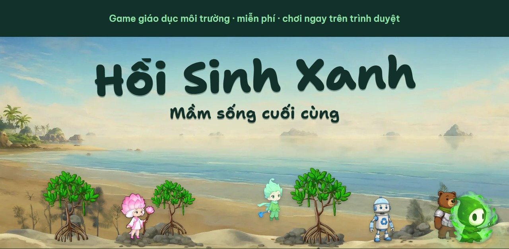

# Hồi Sinh Xanh



Hồi Sinh Xanh là game hành động 2D giáo dục môi trường cho học sinh 12–18 tuổi, miễn phí, chơi ngay trên trình duyệt. Người chơi vào vai **Mầm**, Vệ Binh Xanh cuối cùng, dọn rác, phân loại rác đúng theo Luật Bảo vệ môi trường 2020 và trồng lại rừng ngập mặn để hồi sinh thế giới. Đi kèm game là trang web cho cả lớp: ôn tập bằng Flashcard, thống kê tiến bộ cho học sinh, bảng số liệu và AI tóm tắt cho giáo viên.

Website: [https://sang3232.github.io/EcoHeroes-Mission-Earth/](https://sang3232.github.io/EcoHeroes-Mission-Earth/)

Chơi ngay: [hoi-sinh-xanh.html](https://sang3232.github.io/EcoHeroes-Mission-Earth/hoi-sinh-xanh.html) · Ôn tập Flashcard: [on-tap.html](https://sang3232.github.io/EcoHeroes-Mission-Earth/on-tap.html) · Thống kê: [thong-ke.html](https://sang3232.github.io/EcoHeroes-Mission-Earth/thong-ke.html)

Danh sách công cụ AI đã dùng: xem mục [Công cụ AI và nguồn lực](#công-cụ-ai-và-nguồn-lực).

Cách cài đặt và chạy: xem mục [Cài đặt](#cài-đặt). Nguồn tham khảo: xem mục [Cơ sở nghiên cứu](#cơ-sở-nghiên-cứu-tóm-tắt).

## Tài liệu dự án

- **Thiết kế game** ([thiet-ke-game.md](thiet-ke-game.md)): hệ vật phẩm, kinh tế tuần hoàn, công thức bí ẩn, sinh vật và kế hoạch làm ảnh.
- **Dựng máy chủ lớp học** ([supabase/HUONG_DAN.md](supabase/HUONG_DAN.md)): tạo project, tạo bảng và quyền, cài đặt đăng nhập, khoá AI, đưa hai hàm máy chủ lên.
- **Sinh ảnh cho game** ([qwen/HUONG_DAN.md](qwen/HUONG_DAN.md)): nhân vật, quy trình sinh ảnh bằng Qwen Image.
- **Hướng dẫn chơi và chi tiết kỹ thuật**: từ mục [Điều khiển](#điều-khiển) trở xuống trong file này.

## Nhóm thực hiện

| Họ tên | Vị trí | Vai trò |
|---|---|---|
| Lê Thanh Sang | Trưởng nhóm | Main Developer (Front-end) |
| Trần Nguyên Bá | Thành viên | Developer (Back-end) |
| Quách Gia Phước | Thành viên | Designer + Content + Reporter |

## Bối cảnh vấn đề

Mỗi năm Việt Nam thải ra khoảng 3,1 triệu tấn rác nhựa, ít nhất 10% trôi ra biển. Trên thế giới, chỉ khoảng 9% lượng nhựa từng được sản xuất đã được tái chế. Rừng ngập mặn, lá chắn của bờ biển, đã mất khoảng 60% diện tích so với thập niên 1940. Nguồn của các số liệu này ở mục [Cơ sở nghiên cứu](#cơ-sở-nghiên-cứu-tóm-tắt).

Luật Bảo vệ môi trường 2020 (Điều 75) yêu cầu hộ gia đình, cá nhân phân loại chất thải rắn sinh hoạt thành ba nhóm, và năm 2023 Bộ Tài nguyên và Môi trường đã ban hành hướng dẫn kỹ thuật chi tiết. Học sinh nghe về ô nhiễm rất nhiều qua tiết học, áp phích, buổi nói chuyện, nhưng ít khi được thực hành: một món rác cụ thể thuộc nhóm nào, vì sao hộp xốp dính dầu không bỏ vào thùng tái chế, vì sao phải trồng lại rừng. Hồi Sinh Xanh đưa những quyết định đó vào game để học sinh tự làm, làm sai thì được giải thích ngay.

## Mục tiêu

- Giúp học sinh phân loại rác sinh hoạt đúng ba nhóm theo Luật Bảo vệ môi trường 2020 và hướng dẫn kỹ thuật năm 2023 của Bộ Tài nguyên và Môi trường, qua thao tác chọn thùng và ném rác trong game.
- Giúp học sinh hiểu vai trò của rừng ngập mặn (chắn sóng, giữ đất, nơi sống của loài vật) qua việc tự tay trồng đước, trồng bần và thấy loài vật quay về.
- Tạo động lực bằng phản hồi trực quan: dọn rác thì cảnh vật sáng lên, loài vật trở về, người chơi thấy ngay kết quả việc mình làm.
- Cho giáo viên số liệu định lượng (độ chính xác phân loại, món hay nhầm, tiến bộ theo ngày) và bản tóm tắt AI để chọn nội dung ôn tập và thảo luận cho tiết sau.

Định vị ngắn gọn của sản phẩm: **Game hành động giúp học sinh học bảo vệ môi trường bằng cách tự tay làm, kèm số liệu học tập cho giáo viên.**

## Phạm vi và nguyên tắc sử dụng

Hồi Sinh Xanh là công cụ hỗ trợ giáo dục môi trường, không phải bài kiểm tra hay công cụ đánh giá năng lực. Các chỉ số trên trang Thống kê phản ánh việc chơi game, không dùng để xếp loại, gán nhãn hay kỷ luật học sinh.

- Minigame phân loại rác giữ nguyên ở mọi mức độ khó, để số liệu học tập so sánh được giữa các học sinh.
- Học sinh không cần email: giáo viên dán danh sách tên, hệ thống tạo tài khoản và in phiếu đăng nhập bằng mã lớp.
- Khi giáo viên dùng AI tóm tắt, tên học sinh được đổi thành mã (HS01, HS02…) trước khi gửi đi.
- Không đăng nhập vẫn chơi được đầy đủ; khi đó tiến trình chỉ lưu trên máy.
- Nội dung phân loại rác bám theo Luật Bảo vệ môi trường 2020 và Công văn 9368/BTNMT-KSONMT (2023). Theo Luật, Ủy ban nhân dân cấp tỉnh quyết định việc phân loại cụ thể nhóm rác thải khác, nên khi dạy cần đối chiếu thêm quy định của địa phương.

## Tổng quan sản phẩm

Phiên bản hiện tại gồm:

- **Game** (`hoi-sinh-xanh.html`): hành động 2D kiểu Hollow Knight. Hai màn đã chơi được (Màn 1: Bãi Biển Nhựa, 13 phòng; Màn 2: Rừng Ngập Mặn, 10 phòng) trên bản đồ thế giới 8 màn theo kịch bản. Bốn tinh linh mở khả năng mới; ba boss là hiện thân của rác: Cua Lon Khổng Lồ, Vua Túi Nilon, Lưới Ma Khổng Lồ.
- **Minigame phân loại rác**: Cổng Phân Loại (2 vòng, 18 món, 5 thùng, tính giờ, chấm sao) và Lều bỏ hoang (nhặt từng món rác, ném vào đúng thùng; ném sai thì rác bật ra kèm lời giải thích).
- **Trồng rừng ngập mặn**: Mẹ Đước dạy cắm trụ mầm đước, rễ đước lớn thành cầu qua lạch nước; trồng đủ cây bần thì đom đóm quay về.
- **5 mức độ khó** và chế độ **Tự đánh** ở hai mức dễ, để học sinh nhỏ tuổi hay mới chơi vẫn theo kịp câu chuyện.
- **Trang Giới thiệu** (`index.html`): kéo Mầm để bãi biển hồi sinh, câu chuyện mở đầu, số liệu thật, thử phân loại vài món, phần dành cho giáo viên, truyện tranh 24 trang "Mầm sống cuối cùng".
- **Ôn tập Flashcard** (`on-tap.html`): lật thẻ và bài kiểm tra 10 câu, câu hỏi lấy từ dữ liệu game.
- **Thống kê và lớp học** (`thong-ke.html`, `dang-nhap.html`): học sinh xem tiến bộ của mình so với trung bình lớp; giáo viên tạo lớp, phát tài khoản, xem phân tích, nhận AI tóm tắt và xuất báo cáo Excel hoặc PDF.
- **Tiến trình riêng từng tài khoản**: mỗi tài khoản, và cả chế độ khách, có save riêng; mã save chỉ nhập lại được vào đúng tài khoản đã xuất.
- Chạy trên trình duyệt máy tính và điện thoại (xoay ngang, nút cảm ứng tự hiện), hỗ trợ tay cầm. Game chạy được cả khi không có mạng.

### Phân loại rác trong game

| Nhóm (Luật BVMT 2020, Điều 75) | Thùng trong game | Món trong Cổng Phân Loại |
| --- | --- | --- |
| Rác tái sử dụng, tái chế được | Nhựa · Kim loại · Giấy và thủy tinh | Chai nước nhựa, xô nhựa vỡ · lon nước ngọt, bu lông gỉ · báo cũ, thùng các-tông, chai thủy tinh |
| Rác thực phẩm | Rác thực phẩm | Vỏ chuối, xương cá, cơm thừa, rau héo và vỏ rau củ |
| Rác thải khác | Rác thải khác | Khẩu trang đã dùng, giấy vệ sinh đã dùng, hộp xốp dính dầu, túi nilon bẩn, ống hút nhựa, bã cà phê, lá khô |

Bã cà phê và lá khô làm vườn xếp vào rác thải khác theo hướng dẫn kỹ thuật 2023 của Bộ Tài nguyên và Môi trường. Game ghi rõ điều này trong lời gợi ý; riêng bã cà phê có thêm lưu ý rằng ở nhà vẫn ủ phân được.

### Cách diễn giải các chỉ số

| Chỉ số trên trang Thống kê | Ý nghĩa |
| --- | --- |
| Độ chính xác minigame | Số món bỏ đúng thùng trên tổng số món, gộp Cổng Phân Loại và Lều ném rác |
| Tỉ lệ trồng cây | Số ô đã trồng cây trên tổng số ô trồng được trong game |
| Điểm Flashcard | Tỉ lệ câu trả lời đúng trong các bài kiểm tra 10 câu |
| Món cả lớp hay nhầm | Các món rác bị bỏ sai thùng nhiều lần nhất, xếp từ nhiều tới ít |
| Xu hướng theo ngày | Độ chính xác minigame và điểm Flashcard của lớp qua từng ngày: tối đa 30 ngày liền nhau, tính tới ngày lớp chơi gần nhất; ngày không ai chơi để trống |

Các chỉ số này phản ánh lựa chọn trong game, không phải thang đo năng lực chuẩn hoá.

### Mức độ khó

Chọn khi bắt đầu ván mới, đổi lại lúc nào cũng được trong Cài đặt (Esc → Cài đặt). Minigame giữ nguyên ở mọi mức.

| Mức | Thay đổi | Tự đánh |
| --- | --- | --- |
| Rất dễ | Quái chậm hẳn, trúng 2 đòn mới mất 1 lá, Mầm đánh mạnh gấp đôi | Có, bật sẵn |
| Dễ | Quái chậm hơn, mất ít máu hơn, Mầm đánh mạnh hơn | Có, tự bật hoặc tắt |
| Thường | Đúng như thiết kế của game | Không |
| Khó | Quái nhanh hơn, có đòn làm mất 2 lá, quái và boss trâu hơn | Không |
| Rất khó | Mỗi đòn mất 2 lá, quái nhanh và trâu, ít năng lượng; dành cho ai đã thắng mọi boss | Không |

Tự đánh: Mầm tự quay về phía vật gây hại gần nhất (quái, boss đang đánh, túi hay lưới bay tới) và chém khi trong tầm; đã có Ná Tái Chế thì tự bắn khi vật ở xa và đường bay không vướng tường. Người chơi vẫn tự chạy, nhảy, lướt và né.

## Cơ sở nghiên cứu (tóm tắt)

Diễn giải chi tiết nằm trong báo cáo dự án. Dưới đây là các nguồn chính, mỗi nguồn một dòng, kèm loại nguồn. Số trích dẫn lấy theo Crossref (tháng 11/2026), thường thấp hơn số trên Google Scholar.

- [Ngân hàng Thế giới (2022), "A roadmap to stop single-use plastic pollution in Vietnam"](https://www.worldbank.org/en/news/press-release/2022/07/25/a-roadmap-to-stop-single-use-plastic-pollution-in-vietnam) — tổ chức quốc tế (khảo sát làm theo đề nghị của Chính phủ Việt Nam): mỗi năm Việt Nam thải ra đất liền khoảng 3,1 triệu tấn rác nhựa, ít nhất 10% trôi ra biển; nếu không thay đổi, lượng rò rỉ có thể tăng hơn gấp đôi vào năm 2030.
- [Jambeck et al. (2015), "Plastic waste inputs from land into the ocean"](https://doi.org/10.1126/science.1260352) — tạp chí khoa học (Science, rất nổi tiếng, 11.000+ trích dẫn): năm 2010 có khoảng 4,8–12,7 triệu tấn nhựa từ đất liền đổ ra biển; Việt Nam nằm trong năm nước có nhiều rác nhựa không được quản lý đúng nhất.
- [Geyer, Jambeck & Law (2017), "Production, use, and fate of all plastics ever made"](https://doi.org/10.1126/sciadv.1700782) — tạp chí khoa học (Science Advances, rất nổi tiếng, 17.000+ trích dẫn): tính đến năm 2015, chỉ khoảng 9% rác nhựa từng thải ra được tái chế, 12% bị đốt, 79% nằm ở bãi chôn lấp hoặc ngoài môi trường.
- [Saigoneer, "Vietnam has lost 60% of its mangrove forests over the last 70 years"](https://saigoneer.com/vietnam-news/2967-vietnam-has-lost-60-of-its-mangrove-forests-over-the-last-70-years) — báo chí dẫn số liệu Bộ NN&PTNT: rừng ngập mặn Việt Nam giảm từ 408.500 ha năm 1943 còn 168.688 ha năm 2013, tức mất gần 60%.
- [FAO, "Status and trends in mangrove area extent worldwide", mục Việt Nam](https://www.fao.org/4/J1533E/J1533E63.htm) — tổ chức Liên Hợp Quốc (tài liệu đánh giá tài nguyên rừng của FAO): bảng diện tích rừng ngập mặn Việt Nam qua các năm, mốc năm 1943 khoảng 400.000 ha.
- [Menéndez et al. (2020), "The Global Flood Protection Benefits of Mangroves"](https://doi.org/10.1038/s41598-020-61136-6) — tạp chí khoa học (Scientific Reports, đọc miễn phí, 450+ trích dẫn): rừng ngập mặn giúp tránh hơn 65 tỉ USD thiệt hại do lũ mỗi năm và che chắn cho hơn 15 triệu người. Đây là ý "lá chắn của bờ biển" trong game và video.
- [Luật Bảo vệ môi trường số 72/2020/QH14](https://thuvienphapluat.vn/van-ban/Tai-nguyen-Moi-truong/Luat-Bao-ve-moi-truong-2020-431147.aspx), Điều 75 — văn bản luật (Quốc hội): hộ gia đình, cá nhân phân loại chất thải rắn sinh hoạt thành ba nhóm: chất thải có khả năng tái sử dụng, tái chế; chất thải thực phẩm; chất thải rắn sinh hoạt khác.
- [Công văn 9368/BTNMT-KSONMT (02/11/2023) kèm Hướng dẫn kỹ thuật về phân loại chất thải rắn sinh hoạt](https://cdn.thuvienphapluat.vn/uploads/danluatfile/2023/11/08/cong-van-9368-btnmt-kson-2023-ve-phan-loai-chat-thai-ran-sinh-hoat.pdf) — văn bản hướng dẫn của Bộ Tài nguyên và Môi trường: nêu cụ thể từng loại rác thuộc nhóm nào. Game và Flashcard dùng hướng dẫn này để chấm đúng sai.

### Biết nhưng chưa làm: vì sao học sinh cần thực hành

- [Kollmuss & Agyeman (2002), "Mind the Gap: Why do people act environmentally and what are the barriers to pro-environmental behavior?"](https://doi.org/10.1080/13504620220145401) — tạp chí khoa học (Environmental Education Research, rất nổi tiếng, 6.900+ trích dẫn): hiểu biết và thái độ tốt chưa đủ để thành hành động; giữa biết và làm còn nhiều rào cản như thói quen cũ, thiếu điều kiện, không thấy ngay kết quả.
- [Bamberg & Möser (2007), meta-analysis về các yếu tố tâm lý của hành vi bảo vệ môi trường](https://doi.org/10.1016/j.jenvp.2006.12.002) — tạp chí khoa học (Journal of Environmental Psychology, rất nổi tiếng, 3.400+ trích dẫn): tổng hợp 46 nghiên cứu cho thấy hiểu biết về vấn đề chỉ tác động gián tiếp; hành vi gắn với ý định, chuẩn mực đạo đức cá nhân và cảm giác tự tin là mình làm được.
- [Lawson et al. (2019), "Children can foster climate change concern among their parents"](https://doi.org/10.1038/s41558-019-0463-3) — tạp chí khoa học (Nature Climate Change, nổi tiếng, 260+ trích dẫn): sau khi con học chương trình về biến đổi khí hậu ở trường cấp 2, phụ huynh quan tâm tới vấn đề nhiều hơn nhóm đối chứng. Thói quen bắt đầu từ lớp học có thể lan về gia đình.

### Học bằng làm, phản hồi ngay và ôn lại (các cơ chế trong game và web)

- [Freeman et al. (2014), "Active learning increases student performance in science, engineering, and mathematics"](https://doi.org/10.1073/pnas.1319030111) — tạp chí khoa học (PNAS, rất nổi tiếng, 7.400+ trích dẫn): tổng hợp 225 nghiên cứu ở các môn khoa học, kỹ thuật: học chủ động nâng điểm thi khoảng 6%, còn người chỉ nghe giảng có nguy cơ trượt cao gấp 1,5 lần.
- [Hattie & Timperley (2007), "The Power of Feedback"](https://doi.org/10.3102/003465430298487) — tạp chí khoa học (Review of Educational Research, rất nổi tiếng, 10.000+ trích dẫn): phản hồi là một trong những yếu tố tác động mạnh nhất tới việc học, nhất là phản hồi cụ thể về việc vừa làm và cách làm đúng. Trong game, ném rác sai thùng thì rác bật ra kèm lời giải thích.
- [Luo, Zelenika & Zhao (2019), "Providing immediate feedback improves recycling and composting accuracy"](https://doi.org/10.1016/j.jenvman.2018.11.061) — tạp chí khoa học (Journal of Environmental Management, Đại học British Columbia; nguồn gần Cổng Phân Loại nhất): người chơi game phân loại rác có phản hồi sau mỗi lượt phân loại đúng hơn, kể cả khi đã tắt phản hồi, và vẫn giữ được sau một tuần; khi thử ở ký túc xá, rác hữu cơ thu được tăng còn rác bỏ lẫn giảm.
- [Roediger & Karpicke (2006), "Test-Enhanced Learning"](https://doi.org/10.1111/j.1467-9280.2006.01693.x) — tạp chí khoa học (Psychological Science, rất nổi tiếng, 2.300+ trích dẫn): tự kiểm tra để gợi nhớ giúp nhớ lâu hơn đọc đi đọc lại. Đây là lý do có Flashcard và bài kiểm tra 10 câu.
- [Dunlosky et al. (2013), "Improving Students' Learning With Effective Learning Techniques"](https://doi.org/10.1177/1529100612453266) — tạp chí khoa học (Psychological Science in the Public Interest, rất nổi tiếng, 2.400+ trích dẫn): trong 10 kỹ thuật học phổ biến, tự kiểm tra và ôn giãn cách nhiều buổi được xếp hữu ích nhất.

### Game cho giáo dục môi trường (gần Hồi Sinh Xanh nhất)

- [Douglas & Brauer (2021), "Gamification to prevent climate change: a review of games and apps for sustainability"](https://doi.org/10.1016/j.copsyc.2021.04.008) — tạp chí khoa học (Current Opinion in Psychology, 220+ trích dẫn): tổng quan các game và ứng dụng vì môi trường đã được đánh giá (giáo dục bền vững, tiết kiệm năng lượng, xử lý rác, tiết kiệm nước…): hướng đi hứa hẹn, nhưng chưa rõ vì sao game này hiệu quả hơn game kia và tác dụng kéo dài bao lâu.
- [Fernández Galeote et al. (2021), "Gamification for climate change engagement: review of corpus and future agenda"](https://doi.org/10.1088/1748-9326/abec05) — tạp chí khoa học (Environmental Research Letters, đọc miễn phí, 90+ trích dẫn): tổng quan hệ thống 64 công trình với 56 cách trò chơi hoá nhằm kéo người dân tham gia vấn đề khí hậu, kèm hướng nghiên cứu tiếp theo.
- [Ouariachi, Li & Elving (2020), "Gamification Approaches for Education and Engagement on Pro-Environmental Behaviors"](https://doi.org/10.3390/su12114565) — tạp chí khoa học (Sustainability, đọc miễn phí, 110+ trích dẫn): từ 181 nền tảng, rút ra các yếu tố giúp trò chơi hoá thay đổi hành vi: ý nghĩa, cảm giác làm chủ, ảnh hưởng xã hội, vừa sức, có thử thách và đáng tin. Hồi Sinh Xanh có nhiệm vụ của Mầm, thế giới đổi màu khi dọn rác, năm mức độ khó và nội dung theo luật.
- [Hallinger et al. (2020), tổng quan thư mục về mô phỏng và serious game cho giáo dục bền vững, 1997–2019](https://doi.org/10.1016/j.jclepro.2020.120358) — tạp chí khoa học (Journal of Cleaner Production, 110+ trích dẫn): phân tích 376 tài liệu; lĩnh vực phát triển mạnh từ năm 2010 nhưng phần lớn là bài bình luận, chỉ khoảng một phần ba là nghiên cứu thực nghiệm. Vì vậy Hồi Sinh Xanh ghi lại số liệu học tập để thầy cô tự kiểm chứng.

### Nội dung game bám sinh thái rừng ngập mặn

- [Jusoh, Hashim & Ibrahim (2010), "Firefly distribution and abundance on mangrove vegetation assemblages in Sepetang estuary, Peninsular Malaysia"](https://doi.org/10.1007/s11273-009-9172-4) — tạp chí khoa học (Wetlands Ecology and Management): đom đóm *Pteroptyx tener* ưa tụ ở quần thể cây bần chua (*Sonneratia caseolaris*) xen dừa nước. Ở Màn 2, trồng đủ cây bần thì đom đóm quay về.
- [Tinh et al. (2022), "Mangrove restoration in Vietnamese Mekong Delta during 2015–2020: Achievements and challenges"](https://doi.org/10.3389/fmars.2022.1043943) — tạp chí khoa học (Frontiers in Marine Science, đọc miễn phí): các dự án và chương trình phục hồi đã giữ và tăng diện tích rừng ngập mặn ở Đồng bằng sông Cửu Long. Trồng đước, trồng bần trong game là việc đang được làm thật.

### Game và trò chơi hoá trong giáo dục nói chung

- [Wouters et al. (2013), "A meta-analysis of the cognitive and motivational effects of serious games"](https://doi.org/10.1037/a0031311) — tạp chí khoa học (Journal of Educational Psychology, nổi tiếng, 1.500+ trích dẫn): serious game giúp học và ghi nhớ tốt hơn cách dạy truyền thống, nhất là khi kết hợp hướng dẫn thêm và chơi nhiều buổi; riêng về tạo hứng thú thì chưa hơn rõ rệt.
- [Clark, Tanner-Smith & Killingsworth (2016), "Digital Games, Design, and Learning"](https://pmc.ncbi.nlm.nih.gov/articles/PMC4748544) — tạp chí khoa học (Review of Educational Research, đọc miễn phí, 1.000+ trích dẫn): game số cải thiện kết quả học tập so với cách học không dùng game, và cách thiết kế game ảnh hưởng nhiều tới hiệu quả.
- [Sailer & Homner (2020), "The Gamification of Learning: a Meta-analysis"](https://doi.org/10.1007/s10648-019-09498-w) — tạp chí khoa học (Educational Psychology Review, nổi tiếng, 1.300+ trích dẫn): trò chơi hoá có tác động tích cực nhỏ tới kết quả học, động lực và hành vi học tập.

### Số liệu cho giáo viên, AI và quyền riêng tư

- [Schwendimann et al. (2017), "Perceiving Learning at a Glance: A Systematic Literature Review of Learning Dashboard Research"](https://doi.org/10.1109/TLT.2016.2599522) — tạp chí khoa học (IEEE Transactions on Learning Technologies, 440+ trích dẫn): bảng số liệu học tập giúp giáo viên nắm nhanh tình hình lớp, nhưng còn ít nghiên cứu đo tác động lên việc học. Vì vậy trang Thống kê chỉ tóm tắt, quyết định vẫn thuộc về thầy cô.
- [UNESCO (2023), "Guidance for generative AI in education and research"](https://unesdoc.unesco.org/ark:/48223/pf0000386693) — tổ chức Liên Hợp Quốc (UNESCO): khuyến nghị bảo vệ dữ liệu cá nhân, cân nhắc giới hạn độ tuổi và để con người làm chủ khi đưa AI tạo sinh vào trường học. Hồi Sinh Xanh không cho học sinh trò chuyện với AI: chỉ giáo viên dùng AI tóm tắt, và tên học sinh được ẩn trước khi gửi.
- [Luật Bảo vệ dữ liệu cá nhân số 91/2025/QH15](https://thuvienphapluat.vn/van-ban/Bo-may-hanh-chinh/Luat-Bao-ve-du-lieu-ca-nhan-2025-so-91-2025-QH15-625628.aspx) — văn bản luật (Quốc hội, hiệu lực từ 01/01/2026): người có dữ liệu được quyền biết, đồng ý, truy cập, chỉnh sửa và yêu cầu xoá dữ liệu; cấm mua bán dữ liệu cá nhân. Web chỉ lưu dữ liệu cần cho học tập, và giáo viên xoá được học sinh, lớp học.

## Hệ thống AI và nguyên tắc an toàn

Hồi Sinh Xanh chỉ dùng AI ở một chỗ: bản tóm tắt lớp học cho giáo viên trên trang Thống kê. Học sinh không trò chuyện với AI.

### AI tóm tắt cho giáo viên

- Chạy trong hàm máy chủ `supabase/functions/tom-tat-lop` (Supabase Edge Function). Khoá OpenRouter nằm trong Secrets của máy chủ, không có trong mã web.
- Chỉ giáo viên chủ lớp gọi được; mỗi lớp tối đa một lần mỗi phút; dùng số liệu 90 ngày gần nhất.
- Mô hình chính `z-ai/glm-5.3-flash` qua OpenRouter, chỉ đi qua nhà cung cấp không lưu dữ liệu. Khi mô hình chính lỗi hoặc quá tải, máy chủ thử một chuỗi mô hình miễn phí dự phòng.
- Bản tóm tắt hiện cùng thời điểm tạo và tên mô hình đã viết nó.

### Nguyên tắc an toàn và quyền riêng tư

- **Ẩn danh**: tên học sinh được đổi thành mã HS01, HS02… trước khi gửi cho AI. Bảng đổi mã lưu cùng kết quả để trang của giáo viên hiện lại tên thật.
- **Chỉ dựa vào số liệu**: AI không được bịa số hay suy đoán điều số liệu không cho thấy; khi dữ liệu ít phải nói rõ là chưa đủ để kết luận.
- **Không chẩn đoán, không xếp loại**: số liệu chỉ phản ánh việc chơi game, không dùng để gán nhãn năng lực hay tính cách, xếp loại hay kỷ luật học sinh.

### Cấu trúc lời nhắc (prompt)

- *Vai trò*: trợ lý phân tích học tập của Hồi Sinh Xanh; người đọc là giáo viên; viết tiếng Việt rõ ràng, ngắn gọn, tôn trọng.
- *Dữ liệu vào* (JSON): số học sinh và số học sinh có hoạt động, số liệu theo tuần, món rác hay nhầm, tỉ lệ sai Flashcard theo chủ đề, số liệu từng học sinh theo mã.
- *Đầu ra bắt buộc*, mỗi mục 2–5 gạch đầu dòng:
  1. Tổng quan
  2. Xu hướng theo thời gian
  3. Điểm mạnh của lớp
  4. Kiến thức lớp hay nhầm
  5. Học sinh cần quan tâm thêm
  6. Gợi ý hoạt động cho tiết sau
  7. Giới hạn của dữ liệu

## Công cụ AI và nguồn lực

| Phần việc | Công cụ |
| --- | --- |
| Ảnh nhân vật, quái, boss, đồ vật, nền trong game | Qwen-Image-2.1 chạy trên máy (chỉ dùng phi thương mại), công cụ ở `qwen/` |
| Truyện tranh 24 trang (cũng dùng làm ảnh minh hoạ trên web) | Antigravity (Google) và `openai/gpt-image-2.5-sunburst` qua OpenRouter |
| AI tóm tắt lớp học | `z-ai/glm-5.3-flash` qua OpenRouter, dự phòng bằng các mô hình miễn phí |
| Giọng đọc video giới thiệu | Higgs Audio của Boson AI, chạy trên máy |
| Nhạc nền video giới thiệu | Google Lyria |
| Hỗ trợ viết mã | Claude Code (Anthropic) |

Thư viện mã nguồn mở dùng trên web: [Supabase JS](https://github.com/supabase/supabase-js) 2.115.0 (đăng nhập, dữ liệu lớp học), [Chart.js](https://www.chartjs.org/) 4.4.1 (biểu đồ), [SheetJS](https://sheetjs.com/) 0.18.5 (xuất Excel), [jsPDF](https://github.com/parallax/jsPDF) 2.5.1 và jsPDF-AutoTable 3.8.2 (xuất PDF). Phông chữ: Be Vietnam Pro và Shantell Sans (Google Fonts).

## Yêu cầu hệ thống

- **Chơi**: một trình duyệt hiện đại (Chrome, Edge, Firefox hoặc Safari) trên máy tính, điện thoại hoặc máy tính bảng. Game và web đều là trang tĩnh, không cần build.
- **Chạy trên máy**: [Git](https://git-scm.com/) (hoặc tải ZIP từ GitHub) và [Python 3](https://www.python.org/) hoặc [Node.js](https://nodejs.org/) để mở máy chủ tĩnh.
- **Chế độ lớp học** (không bắt buộc): một dự án [Supabase](https://supabase.com/) (gói miễn phí đủ cho vài lớp) và khoá [OpenRouter](https://openrouter.ai/) cho AI tóm tắt.
- **Chạy bộ kiểm tra**: [Node.js](https://nodejs.org/).

## Cài đặt

Chọn cách phù hợp:
- chỉ chơi thì làm cách 1 hoặc 2;
- muốn chạy hay sửa mã trên máy thì làm cách 3;
- giáo viên muốn dùng tài khoản lớp học thì làm thêm cách 4.

### 1) Chơi ngay trên trình duyệt

Mở [game](https://sang3232.github.io/EcoHeroes-Mission-Earth/hoi-sinh-xanh.html), hoặc vào [trang Giới thiệu](https://sang3232.github.io/EcoHeroes-Mission-Earth/) rồi bấm **Chơi ngay**. Không cần cài gì thêm.

- Trên điện thoại, xoay ngang máy, nút cảm ứng sẽ tự hiện.
- Game tự lưu trong trình duyệt khi bạn ngồi ở Trạm Tái Chế, khi sang phòng mới và khi nhặt đồ quan trọng.
- Đăng nhập tài khoản lớp học ở trang [Đăng nhập](https://sang3232.github.io/EcoHeroes-Mission-Earth/dang-nhap.html) thì kết quả học tập được gửi lên lớp.

### 2) Thêm game ra màn hình chính

Biểu tượng trên màn hình chính mở thẳng game như một ứng dụng. Tiến trình vẫn lưu trong trình duyệt đã dùng để thêm.

- **Android (Chrome)**: mở trang game → menu ⋮ → **Thêm vào màn hình chính** (Add to Home screen) → **Thêm**.
- **iPhone, iPad (Safari)**: mở trang game → nút **Chia sẻ** → **Thêm vào MH chính** (Add to Home Screen) → **Thêm**.
- **Máy tính (Chrome)**: menu ⋮ → **Truyền, lưu và chia sẻ** (Cast, save, and share) → **Cài đặt trang dưới dạng ứng dụng** (Install page as app) → **Cài đặt**.
- **Máy tính (Edge)**: menu … → **Ứng dụng** (Apps) → **Cài đặt trang web này dưới dạng ứng dụng** (Install this site as an app) → **Cài đặt**.

Tên mục có thể hơi khác tuỳ phiên bản trình duyệt.

### 3) Chạy trên máy của bạn

1. Tải mã nguồn bằng Git:

   ```bash
   git clone https://github.com/sang3232/EcoHeroes-Mission-Earth.git
   cd EcoHeroes-Mission-Earth
   ```

   Hoặc trên trang GitHub bấm **Code → Download ZIP**, giải nén, rồi mở terminal trong thư mục vừa giải nén.

2. Mở máy chủ tĩnh ở thư mục repo, chọn một trong hai lệnh:

   ```bash
   python -m http.server 8000
   ```

   ```bash
   npx serve -l 8000
   ```

3. Mở trình duyệt vào trang Giới thiệu:

   ```text
   http://localhost:8000
   ```

   Vào thẳng game ở `http://localhost:8000/hoi-sinh-xanh.html`.

Chỉ chơi thử thì bấm đúp `hoi-sinh-xanh.html` cũng được, vì game không cần mạng. Riêng đăng nhập lớp học cần mở qua máy chủ như ở bước 2.

### 4) Bật chế độ lớp học (cho giáo viên, không bắt buộc)

Chưa làm bước này thì web vẫn chạy ở chế độ khách. Chỉ cần làm một lần, khoảng 10 phút. Hướng dẫn từng màn hình ở [supabase/HUONG_DAN.md](supabase/HUONG_DAN.md).

1. Tạo project trên [Supabase](https://supabase.com/). Chép **Project URL** và **Publishable key** vào `js/web/cau_hinh.js`. Không chép khoá service role hay secret key vào mã web.
2. Vào **SQL Editor**, dán toàn bộ `supabase/schema.sql` rồi bấm **Run** để tạo bảng và quyền.
3. Trong **Authentication**, tắt **Confirm email**, rồi đặt **Site URL** và **Redirect URLs** theo địa chỉ web của bạn.
4. Trong **Edge Functions → Secrets**, thêm `OPENROUTER_API_KEY` để dùng AI tóm tắt.
5. Đưa hai hàm máy chủ lên. Mã project là đoạn chữ trong `https://<mã project>.supabase.co`.

   ```bash
   npx supabase login
   ```

   ```bash
   npx supabase functions deploy quan-ly-hoc-sinh --project-ref <mã project>
   ```

   ```bash
   npx supabase functions deploy tom-tat-lop --project-ref <mã project>
   ```

6. Mở `dang-nhap.html` → **Giáo viên** → **Tạo tài khoản giáo viên**. Sau đó vào **Thống kê** tạo lớp, dán tên học sinh rồi in phiếu đăng nhập.

### 5) Đưa bản của bạn lên mạng (GitHub Pages)

1. Fork repo này về tài khoản GitHub của bạn.
2. Vào **Settings → Pages**. Ở mục **Build and deployment**, chọn **Deploy from a branch**, nhánh `main`, thư mục `/ (root)`, rồi bấm **Save**.
3. Sau khoảng một phút, web có địa chỉ `https://<tên tài khoản>.github.io/EcoHeroes-Mission-Earth/`. Nếu dùng chế độ lớp học, sửa **Site URL** và **Redirect URLs** trong Supabase theo địa chỉ mới này.

### 6) Chạy bộ kiểm tra

Cần có Node.js. Ví dụ, lệnh sau kiểm tra mọi màn đều đi được hết:

```bash
node kiem_tra/duong_di.js
```

Danh sách đầy đủ ở mục [Kiểm tra](#kiểm-tra).

## Cấu trúc chính của project

```text
index.html              Trang Giới thiệu: kéo Mầm hồi sinh bãi biển, câu chuyện, số liệu, đọc truyện tranh, hỏi đáp
hoi-sinh-xanh.html      Game
on-tap.html             Ôn tập Flashcard: lật thẻ, kiểm tra 10 câu
thong-ke.html           Thống kê: khách, học sinh, bảng điều khiển giáo viên
dang-nhap.html          Đăng nhập: học sinh bằng mã lớp, giáo viên bằng email
css/style.css           Giao diện game
css/web.css             Giao diện web (phong cách truyện tranh sáng)
js/                     Mã game, xem bảng ở mục Nơi chỉnh sửa chính
js/levels/              Các màn vẽ bằng ký tự (m1.js, m2.js)
js/web/                 Mã web: tài khoản, đồng bộ, ôn tập, thống kê, lớp học, phân tích, xuất file
assets/                 Ảnh game; assets/web/ là ảnh web và truyện tranh
supabase/               schema.sql, hàm máy chủ quan-ly-hoc-sinh và tom-tat-lop, HUONG_DAN.md
kiem_tra/               Bộ kiểm tra màn chơi, boss, nhật ký trận
qwen/                   Công cụ sinh ảnh bằng Qwen Image
thiet-ke-game.md        Tài liệu thiết kế game
```

## Nơi chỉnh sửa chính

| File | Nội dung |
|---|---|
| `js/data.js` | Vật phẩm, công thức, tinh linh, quái, boss, puzzle, kiến thức. Cân bằng game và danh sách món rác sửa ở đây |
| `js/levels/m1.js` | 13 phòng Màn 1 vẽ bằng ký tự (ghi chú ký hiệu ở đầu file). Sửa màn không cần đụng code |
| `js/levels/m2.js` | 10 phòng Màn 2, thêm ký hiệu nước ngập, bãi bồi, cầu rễ, lưới ma, Mẹ Đước (ghi ở đầu file) |
| `js/hoi_thoai.js` | Khung lời thoại, lời dẫn, thẻ tên màn, bong bóng thoại, bỏ qua cảnh |
| `js/cot_truyen.js` | Lời thoại và các cảnh truyện Màn 1, Màn 2; lời Mẹ Đước đổi theo tiến trình |
| `js/engine.js` | Bàn phím, chuột, tay cầm, cảm ứng; các bộ phím và đổi phím (`HSX.Phim`); va chạm với lưới ô |
| `js/player.js` | Mầm: chạy, nhảy, lướt (cả lướt né), chém, bắn ná, hồi máu, đập xuống |
| `js/enemies.js` | Quái, mini-boss, boss: giáp và sơ hở, chọn chiêu theo chỗ Mầm đứng, đòn giả, phản đòn |
| `js/do_kho.js` | 5 mức độ khó và Tự đánh: bọc hàm gốc để nhân sát thương, tốc độ quái, máu mất, năng lượng; bảng chọn khi bắt đầu ván mới; khối Độ khó trong Cài đặt |
| `js/state.js` | Trạng thái và lưu game; mã save gắn với tài khoản |
| `js/kho_tai_khoan.js` | Khoá lưu theo tài khoản (`<khoá gốc>@<id tài khoản>`), chuyển dữ liệu chờ gửi cũ sang đúng tài khoản |
| `js/spirits.js` | Tinh linh bay theo |
| `js/world.js` | Phòng, chuyển phòng, đồ rơi, Trạm, lồng, cổng, ánh sáng, camera |
| `js/render.js` | Vẽ nền, ô gạch, nhân vật, ánh sáng và không khí (xem mục "Không khí và ánh sáng"), HUD |
| `js/systems.js` | Chế tạo, bùa, nâng Vợt, thí nghiệm, cây, sinh vật |
| `js/ui.js` | Menu tạm dừng, menu Trạm, bản đồ, Sổ (cả Sổ quái vật), hộp thoại, nút cảm ứng |
| `js/huong_dan.js` | Hướng dẫn từng bước theo thao tác, mẹo theo tình huống |
| `js/ghi_tran.js` | Nhật ký trận boss: ghi hành động của Mầm và boss, giữ 10 trận, tải file JSON (xem mục "Nhật ký trận boss") |
| `js/phat_lai.js` | Xem lại trận boss như phim từ nhật ký: dựng lại bằng trình vẽ của game, tua, đổi tốc độ |
| `js/puzzle.js` | Puzzle Cổng Phân Loại |
| `js/thong_ke.js` | Ghi kết quả học tập (Cổng Phân Loại, Lều ném rác, trồng cây) vào máy, riêng từng tài khoản, không đụng save. Xem mục "Web, tài khoản và thống kê" |
| `js/web/` | `tai_khoan.js` đăng nhập, `dong_bo.js` gửi kết quả lên lớp, `on_tap.js` Flashcard, `thong_ke_web.js` trang học sinh, `lop_hoc.js` và `phan_tich.js` trang giáo viên, `tinh_so_lieu.js` cách tính chỉ số, `xuat_file.js` xuất Excel / PDF, `gioi_thieu.js` trang Giới thiệu |
| `supabase/functions/` | `quan-ly-hoc-sinh` tạo tài khoản học sinh, `tom-tat-lop` AI tóm tắt lớp |
| `js/gian_lan.js` | Mã gian lận để thử nhanh, gỡ được (xem mục "Mã gian lận") |
| `qwen/` | Công cụ sinh ảnh bằng Qwen Image, xem `qwen/HUONG_DAN.md` |
| `kiem_tra/` | Công cụ kiểm tra màn chơi (xem mục "Kiểm tra") |

## Điều khiển

Chọn bộ phím trong **Cài đặt → Điều khiển**: hai bộ sẵn (bảng dưới) hoặc **✏️ Tùy chỉnh**. Lần đầu chơi, game tự chọn bộ sẵn theo phím bạn bấm trước: Z, X, C là bộ Chỉ bàn phím; Shift, F, Q, W hoặc bấm chuột là bộ Bàn phím + chuột. Ở hai bộ sẵn, phím mũi tên luôn chạy / nhìn được, chuột trái chém, chuột phải bắn. Tab, M, Esc cố định ở mọi bộ.

**Tùy chỉnh:** bộ này bắt đầu từ các phím đang dùng. Mỗi hành động có hai ô phím: bấm vào một ô rồi bấm phím mới, hoặc bấm nút chuột (trái, giữa, phải) ngay trên ô đó. Phím đang thuộc hành động khác thì hai bên đổi chỗ cho nhau. Esc để thôi đổi, Backspace để bỏ trống ô. Có nút lấy lại phím theo một bộ sẵn. Bảng phím trong Cài đặt, hướng dẫn và mẹo trong game đều hiện đúng phím đã gán. Nút chuột gán cho Chém thì chém về phía con trỏ, gán cho Bắn ná thì ngắm theo con trỏ.

| Hành động | Bàn phím + chuột | Chỉ bàn phím | Tay cầm |
|---|---|---|---|
| Chạy | A D | ← → | Cần trái / D-pad |
| Nhìn lên / xuống | W S | ↑ ↓ | ↑ ↓ |
| Nhảy (giữ lâu nhảy cao) | Space | Z | A |
| Chém | Chuột trái, chém về phía con trỏ: trỏ trên đầu là chém lên, dưới chân (khi đang nhảy) là chém xuống bật nảy, còn lại chém ngang và nghiêng theo chuột | X, kèm ↑ để chém lên, kèm ↓ khi đang nhảy để chém xuống bật nảy | X |
| Bắn ná (khi có Ná Tái Chế): giữ để ngắm, thả ra để bắn | Chuột phải, ngắm theo con trỏ | D, ↑ ↓ xoay góc, ← → đổi bên | LB, cần phải chọn hướng |
| Lướt (khi có tinh linh Gió) | Shift | C | RB |
| Hồi máu: đứng yên trên đất, giữ nút gần 1 giây (cần Hoa Sen, 33 năng lượng, máu chưa đầy; thiếu điều kiện nào game sẽ báo) | F | A | B |
| Đập xuống (khi có Gấu Rừng) | Q | S | Y |
| Ngồi Trạm, đọc, trồng cây, nhặt rác | E | ↑ | ↑ |
| Xuống khỏi bục gỗ | S + Space | ↓ + Z | |
| Túi đồ / Bản đồ / Tạm dừng | Tab / M / Esc | Tab / M / Esc | Select (bản đồ), Start |
| Nhìn quanh: rê chuột ra mép màn hình, khung nhìn lia theo một phần (chỉnh độ mạnh hoặc tắt trong Cài đặt) | Chuột | | |

Điện thoại: nút trên màn hình; nút Bắn hiện khi đã có ná, giữ nút để ngắm (▲ ▼ xoay góc).

**Hướng dẫn trong game:** bảng nhỏ giữa phía trên màn hình dạy từng thao tác ngay lúc chơi: chạy, nhảy, nhảy cao, ngồi Trạm, chém, chém lên, giải cứu tinh linh. Phím hiện đúng theo thiết bị đang dùng (bàn phím/chuột, tay cầm, cảm ứng), làm đúng thì tự qua bước, có mũi tên chỉ chỗ cần tới. Trên điện thoại, nút cần bấm sáng lên. Các mẹo khác hiện khi gặp tình huống lần đầu: thấy quái, thấy đống rác, đủ năng lượng để hồi máu, có tinh linh mới, lần đầu nhảy trên gai, có ná, lần đầu chém vào giáp boss, boss sơ hở, túi / lưới bay tới (phản đòn), boss lao tới (lướt né)... Tắt hoặc xem lại từ đầu trong **Cài đặt**.

## Có gì trong Màn 1

- **13 phòng nối nhau**, ban đầu tối nhất. Phá đống rác, giải cứu tinh linh và trồng cây thì bãi biển sáng dần. Hạ boss thì bình minh lên. Phòng boss luôn tối.
- **4 tinh linh mở đường**:
  - Hoa Sen: hồi máu.
  - Gió: lướt qua vực gai.
  - Gấu Rừng: đập vỡ nền rác nứt.
  - Tái Chế: hút nguyên liệu.
- **Trạm Tái Chế** (giống ghế ngồi trong Hollow Knight): lưu game, hồi máu, đổi bùa, chế đồ ở Xưởng, nâng cấp Vợt ở Bàn lọc, tìm công thức bí ẩn ở Bàn thí nghiệm.
- **Công cụ mở khu ẩn:** Kính Lúp đi xuyên tường giả, Xuồng Phao đi trên nước độc tới Đảo Rác.
- **Ná Tái Chế** (chế ở Xưởng từ ống nhựa, dây thừng, lon nhôm): vũ khí tầm xa, bắn miễn phí, mỗi phát chờ chừng 1 giây, mạnh bằng một nhát chém. Giữ nút bắn để ngắm, bắn được mọi hướng: hạt bay vòng cung, chấm sáng vẽ trước đường bay và khoanh chỗ hạt sẽ chạm (khoanh đỏ là trúng quái); giữ càng lâu (tới 0,6 giây) thì bắn càng mạnh, càng xa. Chọc quái từ xa, cắt lưới ma giăng, phá túi / lưới boss ném tới, đập đống rác. Bắn trúng được chừng nửa năng lượng so với chém (quái 5, chém được 11; giáp boss 1, chém được 3), nên chém vẫn là cách nạp năng lượng chính. Quái, đống rác bị ná phá thì nguyên liệu rơi ra tự bay về Mầm, kể cả khi rơi bên kia vực hay xuống nước. Quái con do boss gọi ra thì không rơi gì, dù hạ bằng chém hay bắn.
- **Giải đố:**
  - Cổng Phân Loại: phân loại rác theo Luật Bảo vệ môi trường 2020 và hướng dẫn kỹ thuật 2023 của Bộ Tài nguyên và Môi trường (xem mục "Phân loại rác trong game").
  - Lều bỏ hoang: nhặt rác rồi ném vào đúng thùng.
- **Quái:** Chai Lăn, Slime Nilon, Cua Lon (vỏ đỡ đòn phía trước), Lưới Ma. Mini-boss Cua Lon Khổng Lồ, boss Vua Túi Nilon 2 pha (cách đánh xem mục "Đánh boss").
- **4 Mảnh Lá** giấu trong các phòng, đủ 4 mảnh thì thêm 1 lá máu. Có Nhật ký, Sách Đỏ, thẻ "Bạn có biết?".
- **Sổ quái vật** (menu → Sổ → Quái vật): quái lọt vào màn hình lần đầu thì ghi tên và bóng đen; hạ lần đầu thì mở hình động, mô tả và cách đánh; hạ đủ số lần (3 với quái thường, 1 với boss) thì mở thẻ kiến thức về loại rác làm ra nó. Boss diễn lần lượt từng động tác trong sổ.
- **Trồng cây** ở phòng đã sạch, đủ điều kiện thì Còng gió và Rùa biển quay về.

## Cốt truyện và cảnh truyện

Lời thoại theo kịch bản `Hoi_Sinh_Xanh_Kich_Ban.docx`, giữ nguyên tắc của kịch bản: không giảng đạo lý, nhân vật nào cũng có lý do của mình, kể cả boss.

- **Khung lời thoại** có chân dung nhân vật (cắt từ ảnh Qwen), tên, chữ hiện dần; tự đưa lên phía trên khi sẽ che mất Mầm hoặc chỗ camera đang nhìn. Có lời dẫn trên nền đen, thẻ tên màn, viền điện ảnh, camera lia tới chỗ cần xem, bong bóng thoại trên đầu boss giữa trận.
- **Qua lời**: Chém, Nhảy, E, bấm chuột hoặc chạm màn hình. **Bỏ qua cả cảnh**: Esc, Start hoặc ☰. Mỗi cảnh chỉ chạy một lần trong một save.
- **Màn 1**: mở đầu Mầm thức dậy giữa đống rác; mỗi tinh linh được cứu đều nói chuyện với Mầm (Hoa Sen: chữa lành, Gió: không khí, Gấu Rừng: rừng là lá chắn, Tái Chế: vòng tuần hoàn); trang sách cổ Luật Bảo vệ môi trường 2020 ở Cổng Phân Loại; Vua Túi Nilon nói trước trận, gầm lên khi nuốt rác sang pha 2, trăn trối khi thua; cảnh bình minh trên bãi biển, Mầm nhận ra rác không tự mọc ra, rồi bảng tổng kết có nút lên đường sang Màn 2.
- **Màn 2**: tới rừng, gặp Mẹ Đước (bà kể chuyện rừng, dạy trồng đước, cho trụ mầm; nói chuyện lại thì bà cho thêm trụ mầm khi sắp hết và kể chuyện khác), cảnh thấy lạch nước tù, Lưới Ma Khổng Lồ kể nỗi đau của tấm lưới bị bỏ, cá cua thoát ra khi nó buông.
- Nội dung các cảnh ở `js/cot_truyen.js`, cách chạy cảnh ở `js/hoi_thoai.js`. Cảnh tự chạy khi tới gần một chỗ trong phòng khai báo bằng `story` trong file màn.

## Màn 2: Rừng Ngập Mặn

Mở sau khi hạ Vua Túi Nilon. Rừng ngập mặn bị chặt làm đầm nuôi tôm, nước mặn tràn vào đất liền.

- **10 phòng**: Bến Đước (Trạm), Bờ bao đầm tôm, Rừng chết, Nhà Mẹ Đước (Trạm), Lạch nước, Hang rễ, Đầm bỏ hoang, Rặng bần (nhánh phụ phía trên Rừng chết), Cửa rừng (Trạm), Hang Lưới Ma.
- **Trồng đước mở lối**: học từ Mẹ Đước, cắm trụ mầm ở bãi bồi, đước lớn thì rễ vươn ra bắc thành cầu qua nước hoặc lên chỗ cao. Đầm bỏ hoang có ba bãi bồi, rễ đước nối các gò đất thành đường qua đầm.
- **Nước ngập**: rơi xuống là mất máu, Xuồng Phao không đi được. Ở Lạch nước, rác bịt kín cống làm nước tù đọng: đứng lên đống rác, đập xuống (Gấu Rừng) để phá cống, nước rút ra biển, lộ lối xuống Hang rễ. Nước đầm đục lúc đầu, trong dần khi rừng sạch và hồi sinh; lòng hồ có bờ bùn dốc thoai thoải.
- **Lưới ma giăng**: tấm lưới chắn lối (có cá mắc kẹt), chém 3 nhát thì đứt cả tấm, con vật bị mắc được thả ra.
- **Quái mới**: Hộp Xốp (chém vỡ thì tách thành hai Mảnh Xốp nhỏ). **Mini-boss Lưới Ma Khổng Lồ** (22 khung hoạt ảnh cho 6 động tác): lượn trên đầu, quăng lưới (trúng thì bị quấn, bấm chém hoặc nhảy liên tục để vùng ra), lao chéo xuống, sập lưới khi Mầm đứng dưới bụng, gọi Lưới Ma nhỏ; còn nửa máu thì quăng hai tấm lưới lệch nhịp. Cách đánh xem mục "Đánh boss".
- **Loài vật quay về**: Cá thòi lòi (3 cây đước trưởng thành, Đầm bỏ hoang sạch rác), Đom đóm (2 cây bần trưởng thành, Rặng bần sạch rác), Cò trắng (Nhà Mẹ Đước sạch rác, cả khu rừng sạch 70%).
- 4 Mảnh Lá, 2 trang nhật ký (Sổ tay người nuôi tôm, Sổ tay Mẹ Đước), thẻ kiến thức về rừng ngập mặn.

## Đánh boss

Boss không thắng được bằng cách đứng sát chém cho tới khi một bên hết máu. Phải đọc chiêu, né, rồi đánh đúng lúc. Các con số dưới đây là ở mức **Thường**; mức khó khác chỉ đổi sát thương, tốc độ, số lá mất và thời gian bất tử (xem mục "Mức độ khó").

- **Giáp và sơ hở.** Lúc boss thủ thế, chém trúng chỉ gây 40% sát thương, tia lửa xám, chữ "Giáp", được ít năng lượng. Khi boss **sơ hở** (viền vàng, lấp lánh, chữ "Sơ hở!"), đòn đánh ×1,5. Đánh lúc sơ hở mạnh gần gấp 4 lúc boss thủ thế.
- **Sơ hở chỉ đến khi né được.** Đòn của boss trúng Mầm thì chiêu đó không để lộ sơ hở, và sơ hở đang có cũng mất. Ví dụ cú húc trúng Mầm thì boss phanh lại kịp chứ không đâm tường. Đỡ đòn bằng thân rồi phản công không có lời.
- **Phản đòn.** Túi, lưới boss ném tới: đợi nó tới sát rồi chém một nhát dứt khoát thì nó bay ngược về phía boss. Chém liên tục không ngừng thì chỉ phá được nó.
- **Lướt né.** Đang lướt mà dính đòn thì xuyên qua, không mất máu, thời gian chậm lại một nhịp, được thêm năng lượng (thưởng tối đa 1 lần mỗi 1,5 giây).
- **Boss đọc vị.** Boss chọn chiêu theo chỗ Mầm đứng: đứng sát lâu thì bị đòn cận chiến, đứng xa lâu (chỉ bắn ná) hoặc đứng hồi máu thì bị lao tới. Không chiêu nào ra quá 2 lần liền. Đôi khi boss rung người rướn lâu hơn (đòn giả) để không né theo nhịp được. Bị chém dồn 3 nhát (Lưới Ma: 2 nhát) lúc đang thủ thế thì phản công ngay: Cua kẹp càng, Vua nổ túi, Lưới Ma quẫy lưới thành vùng bầu dục quanh mình, rủ xuống tới đất (đứng dưới chém lên cũng dính).
- **Đòn cùng lúc có giới hạn.** Mỗi boss chỉ có một đợt đòn tầm xa đang bay (túi ném, lưới quăng, mưa túi): đợt trước hết mới ra đợt sau. Tối đa 2 quái con. Cua không đập đất khi sóng chấn cũ còn chạy. Vua có trần chung: túi + quái con + sóng chấn không quá 5 (pha 1), 6 (pha 2). Nhiều nhất cùng lúc, chưa kể thân boss: Cua 2 sóng chấn (pha 2: 4), Vua 5 (pha 2: 6), Lưới Ma 1 tấm lưới + 2 quái con (pha 2: 2 tấm + 2).
- Mỗi đòn của boss vẫn chỉ mất 1 lá máu. Mỗi chiêu đều có dấu hiệu báo trước: vùng sáng trước mặt Cua, vòng nét đứt quanh Vua và Lưới Ma, cột tím dưới bụng Lưới Ma, bóng tím dưới đất chỗ túi sắp rơi.

| Boss | Chiêu | Sơ hở |
|---|---|---|
| Cua Lon Khổng Lồ | Đập càng (sóng chấn hai bên), lấy đà lao ngang, kẹp càng khi Mầm đứng sát. Mai lon đỡ đòn chém ngang và hạt ná phía trước; chém sau lưng 2 nhát là nó quay ngoắt lại kẹp. Còn nửa máu: lao dội tường rồi lao tiếp, đập hai nhịp | Lao đâm tường thì lật ngửa; đập xong càng kẹt dưới cát |
| Vua Túi Nilon | Ném túi bay đuổi theo, nhảy đập đất (sóng chấn), lấy đà lao ngang, phồng lên nổ túi khi Mầm đứng sát. Pha 2: nhanh hơn, nhả Slime, túi rơi như mưa từ trần, nhảy đập xong có khi lao luôn | Nhảy đập xong lún xuống cát; lao đâm tường thì choáng; túi phản lại trúng Vua là xé ngay 1 lớp túi. Chém xuống trúng vương miện thì giáp không chặn |
| Lưới Ma Khổng Lồ | Quăng lưới, lao chéo xuống, sập lưới khi Mầm đứng dưới bụng, quẫy lưới khi bị chém dồn 2 nhát, gọi Lưới Ma nhỏ. Pha 2: hai tấm lưới lệch nhịp | Lưới phản lại trúng nó thì nó tự quấn mình rơi xuống đất; lao hụt thì cắm xuống đất kẹt lại |

## Nhật ký trận boss

Game tự ghi lại mỗi trận boss, từ lúc boss bắt đầu đánh tới khi thắng, thua hoặc rời phòng, để xem lại và tìm chỗ cần chỉnh, cả độ khó của boss lẫn cách chơi.

- **Ghi gì:** hành động của Mầm (chém theo hướng nào, nhảy, lướt, lướt né, bắn ná kèm góc và lực, phản đòn, hồi máu, bị quấn, khiên chặn); từng chiêu boss ra, kể cả đòn giả; mỗi lần boss sơ hở; mỗi lần Mầm mất máu và vì chiêu gì; mỗi đòn trúng boss (vào giáp, lúc sơ hở, phản đòn, vương miện, vỏ đỡ) kèm máu boss còn lại. Đòn chém và đòn trúng nào ra lúc Mầm đang bất tử (vừa lướt né, vừa trúng đòn) thì được đánh dấu. Lướt né ghi rõ né được gì, kể cả khi chỉ là lướt xuyên thân boss lúc nó đứng yên. Cứ 0,1 giây chụp lại chỗ đứng, máu, năng lượng, dáng của cả hai bên (đang chém, lướt, ngắm ná, hồi máu...), cùng túi, lưới, sóng chấn, hạt ná, quái con đang có, đủ để xem lại như phim. Thời gian ghi chính xác tới 0,01 giây. Cuối mỗi trận có phần tổng kết và gợi ý tính sẵn.
- **Xem lại như phim:** Cài đặt → **Nhật ký trận boss** → **▶ Xem** cạnh mỗi trận, hoặc **📂 Mở file…** để xem file đã tải về.
  - Trận được dựng lại ngay trong phòng boss bằng chính hình của game: Mầm, boss, túi, lưới, sóng chấn, hạt ná, quái con, số sát thương, chữ "Né!", "Sơ hở!", chớp đỏ khi mất máu, boss gục cuối trận.
  - Thanh thời gian có vạch: đỏ là mất máu, vàng là boss sơ hở, xanh là lướt né, tím là sang pha 2. Bấm vào thanh để nhảy tới chỗ đó. Dưới thanh hiện ba việc vừa xảy ra.
  - Phím: Space dừng / chạy tiếp, ← → lùi / tới 5 giây, `,` `.` lùi / tới 0,1 giây, 1 tới 5 đổi tốc độ (¼×, ½×, 1×, 2×, 4×), Esc thoát.
  - Trong lúc xem, game thật đứng yên và không lưu gì; thoát ra là về đúng chỗ cũ. Đang đánh boss thì phải xong trận mới xem được.
  - File ghi trước bản này (chụp 5 lần mỗi giây, không có đạn) vẫn xem được, chỉ thô hơn.
- **Lấy file:** Cài đặt → **Nhật ký trận boss**. Game giữ 10 trận gần nhất, mỗi trận có nút **Tải** (file JSON), thêm nút **Tải tất cả**. Bật **Tự tải file sau mỗi trận** thì trận nào xong cũng tự tải về. Mã gian lận `nhatky` tải trận gần nhất, `nhatky tatca` tải cả 10 trận.
- **Đọc file:** `node kiem_tra/phan_tich_tran.js <file hoặc thư mục>` in cho từng trận:
  - trang bị, hành động, tỉ lệ chém trúng boss;
  - sát thương theo kiểu đòn, mất máu vì chiêu nào (tách riêng pha 2);
  - bảng chiêu boss: số lần ra, số lần đòn giả, Mầm mất bao nhiêu lá trong lúc boss ra chiêu đó;
  - sơ hở có tận dụng không, phản xạ nhanh hay chậm;
  - lướt né bao nhiêu lần, bao nhiêu lần chỉ là lướt xuyên thân boss, trúng boss bao nhiêu đòn lúc đang bất tử;
  - diễn biến chính theo từng giây, gợi ý.

  Nhiều trận thì in thêm bảng gộp theo boss. Thêm `--chitiet` để in đủ mọi sự kiện.
- Nhật ký chỉ nằm trong bộ nhớ trình duyệt, riêng từng tài khoản, không gửi đi đâu.

## Bản đồ thế giới và đi lại giữa các màn

Menu tạm dừng → **🌏 Thế giới**: bản đồ vẽ tay cả 8 màn theo kịch bản. Màn đã hồi sinh viền vàng; màn chưa mở hoặc chưa làm có ổ khoá, bấm vào thì biết cần hạ boss nào hay sẽ có ở bản sau. Ngồi ở Trạm Tái Chế → **🧭 Lên đường** để sang màn khác: tới Trạm bạn nghỉ lần cuối ở màn đó (chưa nghỉ lần nào thì tới chỗ bắt đầu màn). Bản đồ phòng (🗺️ Bản đồ) và độ sạch tính riêng từng màn; Sách Đỏ gộp loài vật của mọi màn.

## Web, tài khoản và thống kê

Web gồm các trang tĩnh, chạy trên GitHub Pages, không cần build:

| Trang | Nội dung |
|---|---|
| `index.html` | Giới thiệu: kéo Mầm để bãi biển hồi sinh, phần mở đầu kể vì sao Mầm thức dậy giữa bãi rác (cuộn để đọc), vấn đề thật, thử phân loại vài món, tính năng, dành cho giáo viên, đọc truyện tranh 24 trang, hỏi đáp |
| `hoi-sinh-xanh.html` | Game |
| `on-tap.html` | Flashcard Quiz: lật thẻ và kiểm tra 10 câu, câu hỏi lấy từ `js/data.js` |
| `thong-ke.html` | Khách: số liệu trên máy. Học sinh: độ chính xác minigame, tỉ lệ trồng cây, điểm Flashcard, so với trung bình lớp. Giáo viên: quản lý lớp, phân tích, AI tóm tắt tiếng Việt, xuất `.xlsx` / `.pdf` |
| `dang-nhap.html` | Học sinh: mã lớp + tên đăng nhập + mật khẩu (giáo viên tạo hộ). Giáo viên: email |

- Style riêng ở `css/web.css`, mã ở `js/web/`. Ảnh web (khung truyện WebP, ảnh trang Giới thiệu, logo) ở `assets/web/`.
- **Mỗi tài khoản một tiến trình.** Save game lưu ở `localStorage['hoi-sinh-xanh-v2@<id tài khoản>']`, kết quả học tập ở `localStorage['hoi-sinh-xanh-hoc-tap@<id tài khoản>']`; chơi khách dùng khoá không có phần `@<id>`. Vì vậy tiến trình chơi khách trên máy không tự chuyển sang tài khoản nào, và hai bạn dùng chung máy không ghi đè save của nhau. Nếu đổi tài khoản ở thẻ khác khi game đang mở, game lưu rồi tải lại theo tài khoản mới.
- **Mã save gắn với tài khoản.** Cài đặt → **Xuất mã save** cho mã dạng `HSX2.…` để chuyển tiến trình sang máy khác. Mã chỉ nhập được vào đúng tài khoản đã xuất; mã xuất khi chơi khách chỉ nhập được khi chơi khách; mã bị sửa tay sẽ báo hỏng. Đây là cách chống chia save trong lớp, không phải mã hoá an ninh cao.
- Khi học sinh đã đăng nhập, `js/web/dong_bo.js` gửi kết quả học tập lên Supabase; mất mạng thì giữ lại gửi sau.
- Máy chủ lớp học là Supabase: bảng và quyền ở `supabase/schema.sql`, hai hàm máy chủ ở `supabase/functions/`. Cách dựng từ đầu: `supabase/HUONG_DAN.md`. Chưa điền `js/web/cau_hinh.js` thì web vẫn chạy ở chế độ khách.
- Game không cần mạng: mở bằng `file://` hay khi không tải được thư viện thì chỉ mất phần gửi kết quả lên lớp.

## Kiểm tra

- `node kiem_tra/duong_di.js`: kiểm tra mọi màn đi được hết theo đúng thứ tự mở đường (Màn 1: nhận tinh linh, công cụ; Màn 2: gặp Mẹ Đước để trồng đước, phá cống cho nước rút), mọi vật đều tới được, không phòng nào bị kẹt, bản đồ đủ hàng đủ cột, cửa hai phòng nối khớp nhau, id phòng không trùng giữa các màn. `node kiem_tra/duong_di.js m2` để kiểm một màn. Chạy lại mỗi khi sửa file trong `js/levels/`.
- `node kiem_tra/quests.js`: kiểm tra hệ nhiệm vụ dùng chung và vườn đom đóm ở Rặng Bần.
- `node kiem_tra/m2_puzzle.js`: kiểm tra Cổng Rừng (Màn 2) giải được: cống nước nối được, bàn đom đóm có lời giải và cần đúng số cây.
- `node kiem_tra/tai_khoan.js`: kiểm tra đăng nhập và đăng ký (`js/web/tai_khoan.js`) mà không cần mạng — nạp mã thật trong hộp cát với một `supabase-js` giả. Soát: quy tắc email ảo của học sinh, chặn mã lớp / tên đăng nhập sai trước khi gọi máy chủ, gọi `signInWithPassword` / `signUp` đúng tham số, chặn tài khoản học sinh đăng nhập nhầm tab giáo viên, dịch lỗi máy chủ sang tiếng Việt, nhớ và xoá hồ sơ ở `localStorage`, và chế độ khách khi chưa cấu hình máy chủ. Không tạo tài khoản thật.
- `node kiem_tra/bot_lop_hoc.js`: kiểm tra tính đúng đắn của số liệu lớp học bằng **20 học sinh ảo (bot) do AI tạo**, không phải học sinh thật. Bot chơi bằng dữ liệu thật của game (món rác, thùng đúng, ô trồng, câu hỏi Flashcard) và tự đếm câu đúng/sai; bài thử đưa kết quả của bot qua `js/web/tinh_so_lieu.js` rồi so từng chỉ số của từng em và cả lớp. `--seed <số>` đổi bộ dữ liệu, `--ghi <thư mục>` lưu dữ liệu bot ra JSON. Không cần mạng.
- `node kiem_tra/bot_lop_hoc_web.mjs`: cùng 20 bot nhưng chạy trên trang web thật bằng Microsoft Edge (cần `npm i -D playwright-core`). Máy chủ Supabase được thay bằng cơ sở dữ liệu giả trong máy, mọi yêu cầu tới Supabase thật bị chặn. Soát: bot gửi kết quả qua `js/web/dong_bo.js` (gửi lại không trùng, không gửi nhầm kết quả của bạn khác), trang Thống kê của từng em, bảng điều khiển giáo viên, file Excel và PDF xuất ra. Ảnh và file lưu vào `Minh chứng kiểm thử/Bot_AI_20_HS_ao/`.
- `node kiem_tra/tao_manifest.js`: tạo lại `assets/manifest.js` (danh sách ảnh có thật) sau khi thêm hoặc xoá ảnh.
- `kiem_tra/thu_trong_trang.js`: bộ thử chạy trong trang game (mô phỏng từng bước vật lý). Hướng dẫn nạp ở đầu file. Nếu đang bật mã gian lận thì gõ `tat` trước khi chạy.
- `kiem_tra/thu_boss.js`: thử độ khó boss bằng hai con bot chạy trong trang game. `THU_BOSS.dungChem` chỉ đứng sát chém, hồi máu khi đủ năng lượng, không bao giờ né. `THU_BOSS.kheo` giữ khoảng cách, nhảy qua sóng chấn, lướt xuyên cú lao, phản đòn, đánh Slime, chỉ dồn đòn lúc boss sơ hở. Gọi `THU_BOSS.tatCa(bậc Vợt, số lá thêm, số trận, THU_BOSS.kheo)`. Lần thử gần nhất (mức Thường):
  - bot đứng sát chém với Vợt Thô, 5 lá thắng 0/12 trận; với Vợt Sạch, 6 lá cũng 0/12;
  - bot đứng sát chém với trang bị mạnh nhất đạt được trong game (Vợt Tinh khiết, 7 lá, vì cả game chỉ có 8 Mảnh Lá): Cua 0/8, Vua 2/8, Lưới Ma 7/16. Những trận thắng Lưới Ma, bot mất 7 đến 11 lá và phải hồi máu 3 đến 6 lần;
  - bot chơi khéo với Vợt Thô, 5 lá thắng 12/12 (Cua 35–45 giây, Vua 70–100 giây, Lưới Ma 26–35 giây).

  Chạy lại khi chỉnh boss. Bot ghi đè save của trang đang mở, thử xong thì tải lại trang. Trận của bot cũng được ghi vào nhật ký trận boss, đọc bằng `kiem_tra/phan_tich_tran.js` để xem bot thắng thua vì đâu.
- `kiem_tra/phan_tich_tran.js`: đọc file nhật ký trận boss, xem mục "Nhật ký trận boss".

## Mã gian lận (để thử nhanh)

Mở ô gõ mã:
- **Máy tính:** nhấn phím **`** (cạnh số 1), gõ mã rồi Enter. Esc để đóng. Game tạm dừng khi ô đang mở.
- **Điện thoại:** chạm nhanh 5 lần vào góc trên bên trái màn chơi (chỗ quả cầu năng lượng).
- **Console** của trình duyệt: `GL('battu')`, `GL('toi hang vua')`, `GL('?')`.
- Mở `hoi-sinh-xanh.html?thu=1` để hiện thêm **bảng nút bấm** ở đầu màn hình: chọn phòng để tới, đủ tinh linh, công cụ, nguyên liệu, sạch 100%, bất tử, bay, hộp va chạm, hạ boss, đánh lại Cua / Vua / Lưới Ma.

Gõ có dấu hay không dấu, có cách hay không đều được: "bất tử", "bat tu", "battu" là một.

| Mã | Tác dụng |
|---|---|
| `battu` | Bật/tắt bất tử: quái, gai, nước độc không làm mất máu |
| `bay` | Bật/tắt bay xuyên tường: phím hướng để bay, giữ Lướt để bay nhanh, không mất máu |
| `mau` | Đầy máu |
| `themla` | Thêm 1 lá máu tối đa |
| `nangluong` | Bật/tắt năng lượng luôn đầy |
| `tinhlinh` | Có đủ 4 tinh linh |
| `congcu` | Có Kính Lúp, Xuồng Phao, Ná Tái Chế, Rào Chắn và 3 bùa (đeo bùa ở Trạm) |
| `giau` | +20 mỗi nguyên liệu, +30 hạt giống, đầy năng lượng |
| `tatca` | Gộp `tinhlinh`, `congcu`, `giau`, `mau` |
| `sach` | Phá hết đống rác cả màn (độ sạch 100%) |
| `toi <tên phòng>` | Dịch chuyển (mọi màn), ví dụ `toi hang vua`, `toi nha me duoc`. Gõ `toi` để xem tên các phòng |
| `hetquai` | Hạ hết quái trong phòng (không tính boss) |
| `boss` | Hạ boss của phòng đang đứng |
| `goiboss <boss> [2]` | Gọi boss ra đánh ngay trong phòng đang đứng. `<boss>` là `cua`, `vua` hoặc `luoi`; thêm `2` để vào thẳng pha 2, ví dụ `goiboss vua 2`. Gõ `trieu hoi vua` cũng được |
| `phongboss <boss> [2]` | Tới phòng của boss, boss hồi sinh để đánh lại từ đầu, không diễn cảnh truyện; thêm `2` để vào thẳng pha 2. Gõ `danh lai luoi` cũng được. Boss gọi bằng hai mã này hạ xong không diễn cảnh kết, không hiện lại bảng tổng kết màn |
| `nhatky` | Tải file nhật ký trận boss gần nhất; `nhatky tatca` tải cả 10 trận đã ghi |
| `binhminh` | Coi như đã hạ Vua Túi Nilon, bình minh lên, Màn 2 mở |
| `man2` | Mở Màn 2 và đi tới Bến Đước |
| `trongduoc` | Biết trồng đước ngay (như đã gặp Mẹ Đước), +10 hạt giống |
| `caylon` | Mọi cây đã trồng lớn ngay, cầu rễ đước mọc liền |
| `xanuoc` | Phá cống, rút nước ngập trong phòng đang đứng |
| `truyen <tên cảnh>` | Xem lại một cảnh truyện, ví dụ `truyen mo_dau`. Gõ `truyen` để xem danh sách |
| `botruyen` | Coi như đã xem hết cảnh truyện, để thử nhanh không bị dừng |
| `sang <0-100>` | Ép độ sáng để xem không khí, ví dụ `sang 0` (tối nhất), `sang 100`. Gõ `sang` để trả về bình thường |
| `cham` | Bật/tắt quay chậm ×¼, để xem kỹ hoạt ảnh và đòn đánh |
| `nhanh` | Bật/tắt chạy nhanh gấp đôi |
| `hop` | Bật/tắt hiện hộp va chạm: Mầm (xanh), vùng chém (vàng), quái (đỏ), đạn (cam), hướng chuột (trắng) |
| `soquai` | Mở hết Sổ quái vật |
| `huongdan` | Cho hướng dẫn chạy lại từ bước đầu |
| `xoaluu` | Xoá save, chơi lại từ đầu (có hỏi lại) |
| `tat` | Tắt mọi mã đang bật |
| `?` | Xem danh sách mã |

Mã nào đang bật thì hiện ở góc dưới bên trái (🧪). Các mã bật/tắt được nhớ trong thẻ trình duyệt đang mở, tải lại trang vẫn còn. Đóng thẻ thì mất.

**Gỡ khỏi game** (trước khi phát hành): xoá file `js/gian_lan.js` và dòng `<script src="js/gian_lan.js">` ở cuối `hoi-sinh-xanh.html`. Không cần sửa gì khác: file này tự móc vào game từ bên ngoài, game không gọi tới nó. Gỡ xong thì phím `, chạm 5 lần, `GL()` và `?thu=1` đều không còn tác dụng. Còn sót một biến `HSX.DEBUG_GOD` trong `js/player.js`, giữ lại vì bộ thử trong `kiem_tra/` dùng nó, và nó không làm gì khi không ai bật.

## Không khí và ánh sáng

Mỗi khung hình vẽ theo lớp, từ xa tới gần:

1. **Nền xa** (ảnh Qwen ban ngày) nhân với màu đêm của khu, phủ sương nhẹ ở đường chân trời và một dải sương trôi chậm.
2. **Cảnh** (đất, vật, quái, Mầm) vẽ lên lớp riêng rồi **nhân với bản đồ sáng**: màu bóng tối của khu (xanh đêm ở bãi biển, xanh lục lam trong hang, tím ở Đảo Rác và phòng boss) cộng các nguồn sáng có màu (đèn lồng vàng, Trạm xanh lá, lồng giam tím...). Vì là phép nhân nên chỗ tối vẫn giữ màu và chi tiết, và đất đá tối hơn nền nên nổi thành khối. Lòng đất càng sâu càng tối, mép trên có vệt sáng.
3. **Viền**: Mầm có viền xanh nhạt, quái có viền tím, cùng ánh trăng hắt lên mép trên. Viền vẽ sau ánh sáng nên luôn thấy rõ trong bóng tối. Vệt chém cũng vẽ sau ánh sáng.
4. **Quầng sáng** quanh nguồn sáng, **tia sáng** chéo từ trên (trăng xanh khi tối, nắng vàng khi sáng), **sương gần** sát đáy, **bụi lấp lánh** (sáng hơn khi bay gần nguồn sáng), **tiền cảnh** (bóng cỏ, đá, rác sát đáy phòng, thạch nhũ trên trần hang), **viền tối mép màn hình**.

Màn càng sạch thì các màu này càng tiến về ban ngày. Màu từng khu nằm ở `MOOD` đầu `js/render.js`, màu viền ở `RIM`.

**Hiệu ứng** (`fxp`, `hitFx`, `deathFx` trong `js/world.js`, vẽ ở `drawFx` trong `js/render.js`):
- Chém trúng: tia lửa bắn theo hướng chém, vệt chém trắng cắt ngang, vòng sóng, chớp sáng soi cả xung quanh trong phòng tối, màn hình giật nhẹ theo hướng đòn. Năng lượng nhận được bay thành đốm xanh về quả cầu năng lượng, quả cầu lóe sáng khi đốm tới.
- Quái bị hạ nảy trắng rồi tan: mảnh vụn đúng chất liệu (nhựa trong, nilon, lon gỉ, lưới), khói độc tím, đốm xanh bay lên. Đống rác vỡ văng mảnh rác nhiều màu.
- Boss: vòng sóng khi bắt đầu trận, khựng lại khi bị xé một lớp túi, gầm lên khi sang pha 2, gục ngã theo khung hoạt ảnh khi bị hạ.
- Mầm: bụi dưới chân khi chạy, vòng bụi khi rơi từ cao, vệt gió khi lướt, cánh hoa xoáy vào khi hồi máu. Trúng đòn thì viền màn hình chớp đỏ, còn 1 lá máu thì viền đỏ đập theo nhịp tim. Mất lá máu thì lá vỡ rơi xuống, hồi lá thì lá nảy lên.
- Vệt chém quét nhanh như lưỡi liềm, màu theo cấp Vợt (Thô trắng xanh, Sạch xanh ngọc, Tinh khiết vàng). Rung màn hình mượt thay vì giật ngẫu nhiên.

## Ảnh

Mầm (37 khung hoạt ảnh cắt từ bảng khung), ba boss (Vua Túi Nilon 27 khung cho 7 động tác, Cua Lon Khổng Lồ 23 khung cho 6 động tác, Lưới Ma Khổng Lồ 22 khung cho 6 động tác), tinh linh, quái, Mẹ Đước, đồ vật trong màn (đống rác bãi biển và rác đầm tôm, Trạm Tái Chế, lồng, đèn lồng, giá nhật ký, nhà sàn, cây đước), ảnh nền (bãi biển, hang, đảo rác, rừng đước, đầm tôm), mẫu ô gạch (cát, đá, bùn) và bản đồ thế giới đã sinh bằng Qwen. Thiếu ảnh nào thì game tự vẽ thay (Mầm vẽ bằng code, vật phẩm dùng emoji). Muốn đổi hoặc sinh thêm ảnh, xem [qwen/HUONG_DAN.md](qwen/HUONG_DAN.md).

## Giấy phép

### Quyền truy cập repo

Repo [sang3232/EcoHeroes-Mission-Earth](https://github.com/sang3232/EcoHeroes-Mission-Earth) để **công khai**: ai cũng xem, tải về (clone) và chơi thử được. Chỉ thành viên nhóm có quyền đẩy mã (push) lên nhánh `main`; người ngoài muốn góp ý hoặc sửa thì mở Issue hoặc gửi Pull Request.

### Mã nguồn: giấy phép MIT

Mã nguồn (HTML, CSS, JavaScript, SQL, các bài kiểm thử) phát hành theo giấy phép **MIT**, xem file [LICENSE](LICENSE). Bạn được dùng, sửa, chia sẻ, kể cả dùng thương mại, miễn giữ lại dòng bản quyền và lời giấy phép. Mã được cung cấp “nguyên trạng”, không kèm bảo hành.

### Ảnh, truyện tranh và tài nguyên khác: không thuộc MIT

| Tài nguyên | Điều kiện dùng |
|---|---|
| Ảnh trong game (`assets/`, sinh bằng Qwen-Image-2.1) | Chỉ **phi thương mại**: muốn bán game hoặc kiếm tiền từ game thì phải đổi model hoặc xin giấy phép thương mại |
| Ảnh truyện tranh và tài nguyên khác | Cần kiểm tra quyền sử dụng riêng trước khi phát hành thương mại |
| Ảnh, video trong `Minh chứng kiểm thử/` | Minh chứng của nhóm, không cấp phép dùng lại |

### Thư viện bên ngoài (nạp từ CDN, theo giấy phép riêng)

Chart.js 4.4.1 (MIT) · supabase-js 2.115.0 (MIT) · SheetJS xlsx 0.18.5 (Apache-2.0) · jsPDF 2.5.1 và jspdf-autotable 3.8.2 (MIT) · phông Be Vietnam Pro (SIL Open Font License 1.1).
